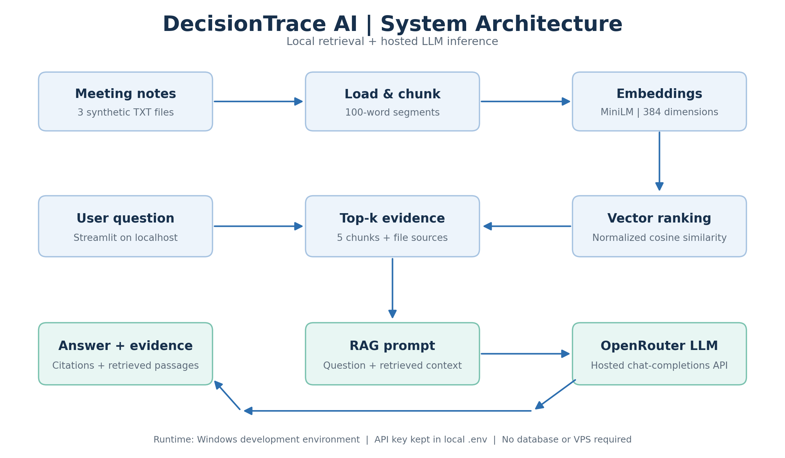

# DecisionTrace AI

### AI-Powered Meeting Decision & Commitment Intelligence

<<<<<<< HEAD

>>>>>>> origin/main

DecisionTrace AI is a Retrieval-Augmented Generation
(RAG) application that helps teams retrieve decisions,
responsibilities, and deadlines from meeting notes.

## Business Problem

Important decisions are often scattered across multiple
meeting documents. Teams may struggle to identify the
latest approved decision or the person responsible.

DecisionTrace AI retrieves relevant meeting evidence
and uses an LLM to generate an answer with source
references.

## System Architecture

DecisionTrace AI uses a Retrieval-Augmented Generation (RAG)
pipeline to retrieve relevant meeting decisions and produce
evidence-grounded answers.

### Architecture Workflow

1. **Document Ingestion:** Load meeting records from TXT files.
2. **Text Chunking:** Split documents into smaller passages.
3. **Embeddings:** Convert passages into 384-dimensional vectors using Sentence Transformers.
4. **Semantic Search:** Retrieve relevant passages using cosine similarity.
5. **RAG & LLM:** Send retrieved context to an LLM through OpenRouter.
6. **Answer Generation:** Produce answers with source references.
7. **Streamlit Dashboard:** Display answers and supporting meeting evidence.

### Technology Stack

- Python
- Sentence Transformers (all-MiniLM-L6-v2)
- NumPy
- OpenRouter API
- Streamlit
- Python unittest

## Installation

Clone the repository and enter the project folder.

Create a virtual environment:

    python -m venv .venv

Activate on Windows PowerShell:

    .\.venv\Scripts\Activate.ps1

Install dependencies:

    python -m pip install -r requirements.txt

Copy .env.example to .env and configure:

    OPENROUTER_API_KEY=your_private_api_key
    OPENROUTER_MODEL=openrouter/free

Run the dashboard:

    python -m streamlit run app.py

## Testing

Run automated tests:

    python -m unittest discover -s tests -p "test_*.py" -v

Run the RAG demonstration:

    python test_rag.py

## Example Questions

- Why was the website launch postponed?
- Who approved the postponement?
- What is the latest approved launch date?
- Who is responsible for payment integration?

## Dataset

Three fictional meeting documents representing
NovaTech Solutions.

The data is synthetic and created for
demonstration purposes.

## Limitations

- Small sample dataset
- TXT files only
- Approximate similarity ranking
- LLM responses can contain errors
- Free model availability may vary
- Not intended for production use

## Security

API keys are stored locally in .env.
Private environment files are excluded from Git.

## Project Status

Local RAG pipeline and Streamlit application implemented.
Automated evaluation and GitHub publication are part
of the final verification process.
